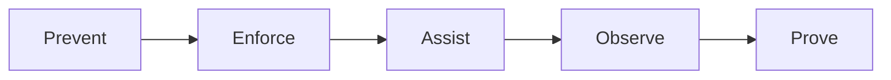

# Defense in depth — layers

Applies to **security boundaries and to any logic change** (e.g. prove layer = tests for invariants).

Assign each control to **one primary layer**. Do not duplicate without a documented reason.

| Layer | Owns | Examples |
| --- | --- | --- |
| **Prevent** | Platform/config | Stable encryption keys, feature flags, network isolation, required env vars fail at boot |
| **Enforce** | Server / database | Guards, ownership checks, `INTO STRICT`, transactions on multi-write, anchored allowlists |
| **Assist** | Client | Double-submit guards, disabled while loading, filter UI to available options |
| **Observe** | Ops | Structured logs, metrics, audit tables, Sentry with handled vs unhandled policy |
| **Prove** | Tests | Unit assertions on arguments; integration/e2e on concurrency and webhooks |

**Rule:** Server is authoritative. Client reduces mistakes and abuse surface; it does not replace authz.

## Layer diagram

## Retry placement

| Operation | Retry? |
| --- | --- |
| Read-only fetch, idempotent GET | Bounded retry with backoff |
| User-initiated **mutating** action (book, pay, reserve) | **No** blind retry on 5xx — user or idempotency key must drive replay |
| Webhook handler | Idempotent on vendor event id; return 2xx on duplicate |

## HTTP semantics (enforcement layer)

| Situation | Prefer |
| --- | --- |
| No session / invalid token | 401 |
| Known caller, forbidden resource | 403 |
| Upstream dependency down | 503 (or typed error), not generic 500 masquerading as empty data |
| Missing resource for this user | 404 with clear product copy if appropriate |

Document trust assumptions in code comments at boundaries (who may set identity headers, why network must isolate backends).